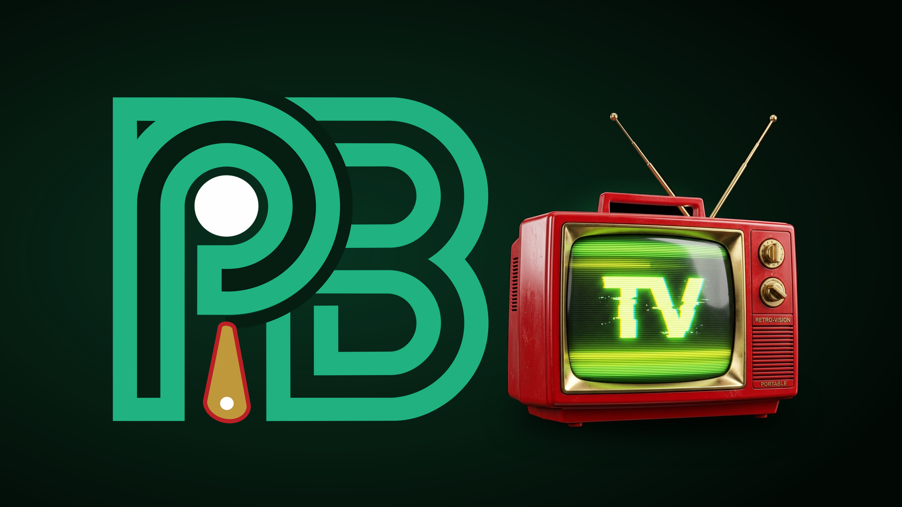

# Pinball Buddies Pincast TV — Commercial Arcade Signage Kiosk

> Commercial Flutter & Dart Kiosk Application (`com.pinballbuddies.venuedisplay`) with hardware wake locks, native watchdog crash recovery, Fire OS power-on auto-boot, and Android Keystore secure storage.
> Turn any Amazon Fire TV Stick into a 24/7 unattended arcade leaderboard & tournament display.



---

## Why the Dedicated Flutter/Dart Commercial Kiosk App?

Consumer TV web browsers (like Amazon Silk) suffer from intrusive address bars, sleep timeouts, no power-on auto-launch, and unrecovered connection drops.

**Pinball Buddies Pincast TV** (`com.pinballbuddies.venuedisplay`) is built with **Flutter & Dart** as a dedicated commercial signage kiosk that renders the full Pinball Buddies live venue display experience (`https://pinballbuddies.com/display`):
- ⚡ **Full Live Venue Display**: Renders multi-machine high score leaderboards, single-machine spotlights, multi-zone screen layouts, active score chases, live tournament brackets, and real-time high-score alert celebrations.
- 🔄 **Native Watchdog & Auto-Recovery Daemon**: Built-in 30-second health watchdog and exponential-backoff reconnect daemon (`5s -> 60s`) automatically recover the screen after venue Wi-Fi blips.
- 🚀 **Fire OS Power-On Auto-Boot**: Native `BootReceiver` + `SYSTEM_ALERT_WINDOW` overlay permission automatically launches the display when the arcade master power strip is switched on.
- 🛡️ **24/7 Sleep Prevention**: Enforces hardware `WakelockPlus`, Android `FLAG_KEEP_SCREEN_ON`, Doze battery exemption, and permanent display timeout.
- 📱 **Cross-Platform QR & Display ID Pairing**: Launches directly into the **Connect Display** QR code screen—scan with your phone camera or enter the 8-character Display ID from the Pinball Buddies iOS app, Android app, or Web app to link your venue or home arcade!
- 🎮 **Remote Kiosk Configuration & Reset**: Press **Back** or **Menu** on the Fire TV remote to open **Kiosk Configuration**, or select **Reset Default** to clear the paired venue session and return to the QR pairing screen.

---

## Quick Start for Humans (1-Click Automated Wi-Fi Installer)

*Installs the signed commercial Flutter/Dart APK over your local Wi-Fi, configures 24/7 arcade kiosk sleep prevention, and auto-launches the display:*

1. On your Fire TV Stick, enable ADB: **Settings > My Fire TV > Developer Options > ADB Debugging > ON**.
2. Note your Fire TV's IP address: **Settings > My Fire TV > About > Network** (e.g. `192.168.1.150`).
3. Download and unzip the latest release package:
   ```bash
   curl -L -o pincast.zip https://github.com/PBJonny/pincast-tv/releases/latest/download/pinball-buddies-pincast-v1.0.0.zip
   unzip pincast.zip
   cd pincast
   ```
4. Run the installer from your computer:
   ```bash
   # macOS / Linux
   ./scripts/setup-firestick.sh 192.168.1.150

   # Windows
   .\scripts\setup-firestick.bat 192.168.1.150
   ```
5. Look at your TV, select **"Always allow from this computer" > OK**, and scan the on-screen QR code from your phone to link your venue!
👉 *Read the full step-by-step walkthrough in **[`HUMAN_INSTALL_GUIDE.md`](./HUMAN_INSTALL_GUIDE.md)**.*

---

## ⚡ Power-On & Boot Behavior (Startup Delay Explained)

> **Important Note for Staff & Operators**:
> When you power on your TV or turn on your arcade master power strip in the morning, Fire OS performs a cold boot and connects to the venue Wi-Fi network.
>
> ⏳ **There is an intentional 30–60 second startup delay timer** before the app launches.
> **The display is not frozen or broken!** 
> This delay guarantees that the Wi-Fi connection and HDMI display handshake are fully established before the app begins streaming live leaderboard scores.
> 
> 👉 **Do not press buttons on the remote.** Pinball Buddies Pincast TV will take over the display automatically!

---

## Automated / CLI Deployment

Deploying via automated scripts or CLI tools?
👉 Refer to **[`AI_AGENT_INSTALL_GUIDE.md`](./AI_AGENT_INSTALL_GUIDE.md)** for deterministic ADB commands, process validation, and error-handling matrices.

---

## Included Files in this Package

```
pincast/
├── pinball-buddies-pincast-tv.apk  # Signed production Flutter/Dart Kiosk APK
├── tv_banner.png                  # 1080p display banner artwork
├── README.md                      # Overview and quick-start guide
├── HUMAN_INSTALL_GUIDE.md         # Step-by-step human guide (1-Click Wi-Fi setup)
├── AI_AGENT_INSTALL_GUIDE.md      # Deterministic CLI / automation playbook
├── SECURITY.md                    # APK signature verification & security disclosure policy
├── CONTRIBUTING.md                # Guidelines for reporting issues & PRs
├── CODE_OF_CONDUCT.md             # Contributor Covenant community standards
├── ACCESSIBILITY.md               # 10-foot arcade readability, D-Pad & motion safety statement
├── manifest.json                  # Release metadata & SHA-256 integrity hash
└── scripts/
    ├── setup-firestick.sh         # macOS/Linux automated APK installer (with SHA-256 check)
    ├── setup-firestick.bat        # Windows automated APK installer (with SHA-256 check)
    └── kiosk-power-settings.sh    # 24/7 ADB display sleep and power tuner
```

---

## Community, Standards & Support

- **Website**: [https://pinballbuddies.com](https://pinballbuddies.com)
- **Support**: [support@pinballbuddies.com](mailto:support@pinballbuddies.com)
- **Contributing**: [`CONTRIBUTING.md`](./CONTRIBUTING.md)
- **Code of Conduct**: [`CODE_OF_CONDUCT.md`](./CODE_OF_CONDUCT.md)
- **Security Policy**: [`SECURITY.md`](./SECURITY.md)
- **Accessibility Statement**: [`ACCESSIBILITY.md`](./ACCESSIBILITY.md)
- **License**: [`MIT License`](./LICENSE)
